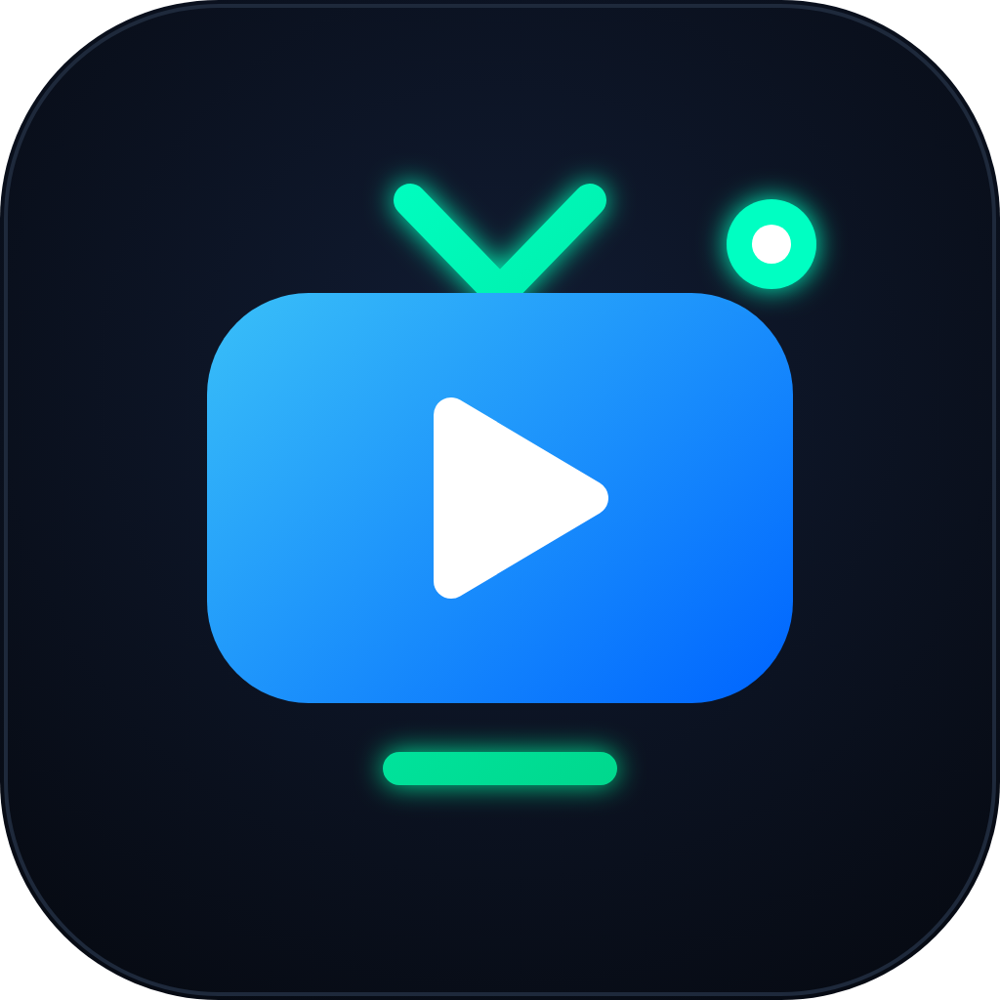
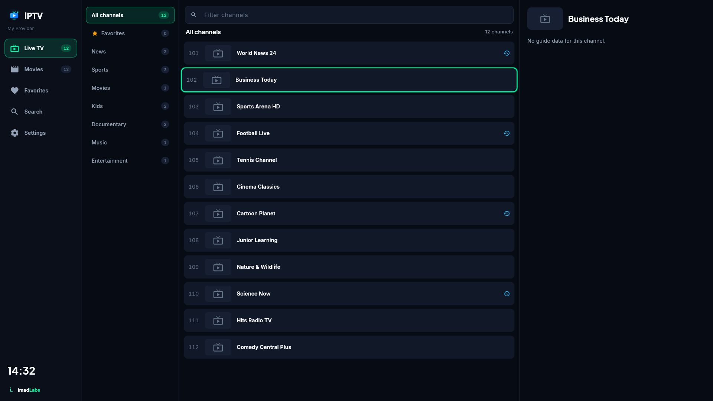
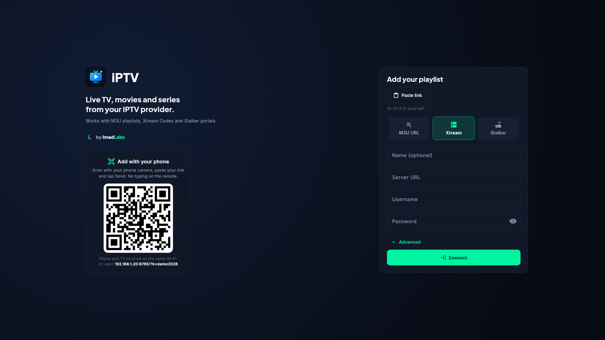
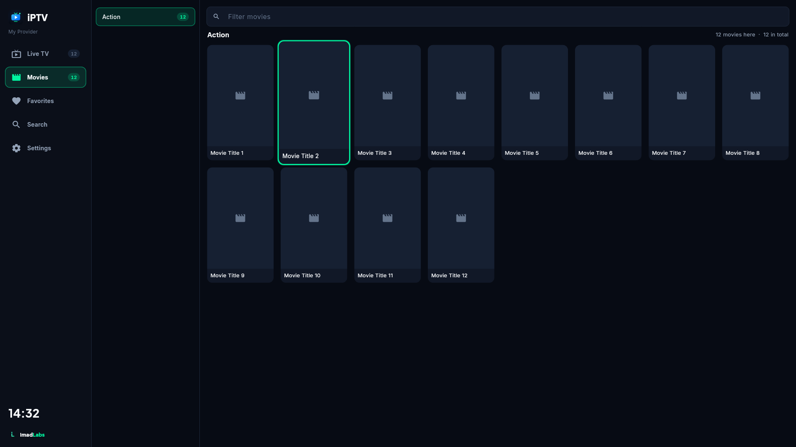
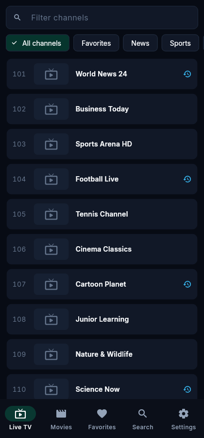

<p align="center">
  
</p>

<h1 align="center">iPTV</h1>
<p align="center">A fast IPTV player for <b>Android</b>, <b>Android TV</b> and <b>Windows</b>, by <b>ImadLabs</b>.</p>

iPTV plays the playlist from your own provider. It ships with no channels or content.



## Features

- **Every common IPTV login**: M3U / M3U8 playlists (URL or file), **Xtream Codes** (username + password) and **Stalker / Ministra portals** (MAC address, plus serial number, device ID 1 and 2, signature and STB model for portals locked to a box).
- **Add a playlist without typing**: the TV shows a QR code. Scan it with your phone, paste the link (or Xtream login, Stalker portal, or pick an .m3u file) and tap Send; the TV connects by itself. Works over your Wi-Fi with no account. There's also **Paste link**, and full Xtream links (`get.php?username=…&password=…`) are split into server, user and password automatically.
- **Copy playlists to another TV**: Settings → *Send playlists to another device* finds other iPTV devices on the same Wi-Fi that have the QR screen open and sends all playlists in one press; the other device starts on the same playlist.
- **Typing with the remote**: OK opens the on-screen keyboard in any text box and up/down move on to the next control.
- **Live TV** with categories, channel numbers, logos, a filter box, and a now / next **TV guide** panel (XMLTV, gzip supported, or the provider's own EPG). Picking a channel plays it in a **preview beside the channel list**; pick it again or press full screen to go big, without restarting the stream.
- **Counts everywhere**: how many channels, movies and series the playlist has, and how many are in each category.
- **Movies and Series** with posters, ratings, plots, seasons and episodes, **resume where you left off**, and auto-play of the next episode.
- **Catch-up / timeshift** for Xtream and M3U playlists that support it (`catchup`, `catchup-source`, flussonic and shift styles).
- **Favorites, recently watched and Continue watching**, kept per playlist.
- **Search everywhere**: channels, movies, series and what's on in the TV guide, with words in any order and accents ignored. **Voice search** with the remote's mic on Android TV (and phones); the remote's search key or Ctrl+F jumps straight to it.
- **Start with the last channel**: the app opens straight into what you watched last, playing (can be turned off).
- **Your own channel groups** ("Sports", "News"…) in your own order, reorderable favorites, and **hidden channels**. Long-press a channel (or right-click) for the menu.
- **Opens instantly**: playlists, lists and the TV guide are saved on the device and refreshed in the background on a schedule you choose; works offline from the saved copy.
- **In-app updates**: checks GitHub releases every time the app opens and again every 30-90 minutes while it runs (also during playback), and installs the new version in one tap (the right APK for your device on Android, the installer on Windows).
- **Several playlists**, switch between them in Settings.
- **Parental control**: 4-digit PIN, lock any category, adult categories hidden or PIN-locked automatically.
- **Player** built on libmpv (media_kit) with hardware decoding, big buffers and auto-reconnect for live streams. Centered play controls, **sound and brightness** controls (swipe on phones, mouse wheel on Windows), audio and subtitle track selection, aspect modes, picture-in-picture on Android phones, and full screen on Windows.
- **Stream info panel**: resolution, video and audio codec, frame rate, bitrate, hardware or software decoding, buffer and dropped frames.
- **Clear loading and errors**: start-up shows each step (link, server, buffering with a percentage, reconnecting), and failures say why: channel offline (404), subscription expired or too many devices (401/403/458), server error (5xx), timeout, no internet.
- **Android TV first-class**: appears on the TV home screen with its own banner, every screen works with the D-pad, and focused items glow in ImadLabs mint.

## Remote control and keyboard

| Remote / key | In the player |
|---|---|
| OK / Enter | Show controls |
| Up / Down, Channel + / − | Previous / next channel (live) |
| Left / Right | Channel list (live), seek 10 s (movies and series) |
| Number keys | Jump to channel number |
| Play/Pause, Space | Play / pause |
| Fast-forward / Rewind | Seek 30 s |
| Info, I | Stream info panel |
| M | Mute |
| + / −, mouse wheel | Volume |
| Back, Esc | Hide controls, then leave the player |
| F, F11 | Full screen (Windows) |

Long-press OK (or right-click) on any channel, movie or series to add it to favorites.

## Screenshots

| Add a playlist | Movies | Phone |
|---|---|---|
|  |  |  |

Regenerate them with `flutter test tool/screenshots_test.dart --update-goldens`.

## Build

Requires Flutter 3.50 (stable).

```bash
flutter pub get
flutter test
flutter run -d windows            # Windows
flutter run                       # connected Android phone or TV
flutter build apk --release --split-per-abi
flutter build windows --release
```

GitHub Actions builds the Android APKs (universal and per-ABI) and the Windows zip and installer on every push. Pushing a `v*` tag publishes them as a GitHub release.

Android release signing reads `android/key.properties` or these repository secrets: `IPTV_KEYSTORE_BASE64`, `IPTV_KEYSTORE_PASSWORD`, `IPTV_KEY_ALIAS`, `IPTV_KEY_PASSWORD`. Without them, builds use the debug key.

Android 7.0 (API 24) or newer is supported, which is the minimum for current Flutter.

## Project layout

```
lib/
  core/            playlist sources, no UI
    sources/       M3U, Xtream Codes and Stalker clients behind one IptvSource interface
    epg/           streaming XMLTV parser
  data/            saved playlists, favorites, history, PIN and settings (JSON file)
  state/           the active connection and guide data
  ui/              screens, player, TV focus widgets and the ImadLabs theme
android/           Android + Android TV (leanback launcher, banner, picture-in-picture)
windows/           Windows runner and Inno Setup installer
branding/          app icon sources and exports (from the ImadLabs Graphics repo)
```

## Branding

The icon follows the ImadLabs brand rules: a Cyber Mint antenna and Electric Cobalt screen on the Deep Void tile, with the ImadLabs quantum dot in the top-right. Its master SVG is `branding/iptv-master-icon.svg`, built with the Graphics repo's `tools/build_app_icons.py`.

© 2026 ImadLabs
